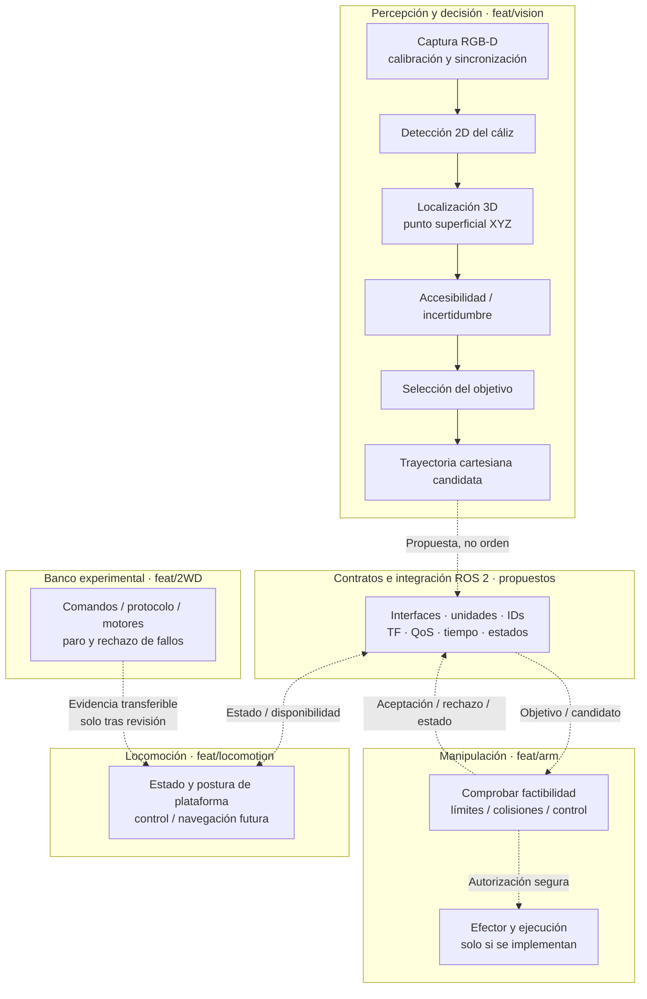
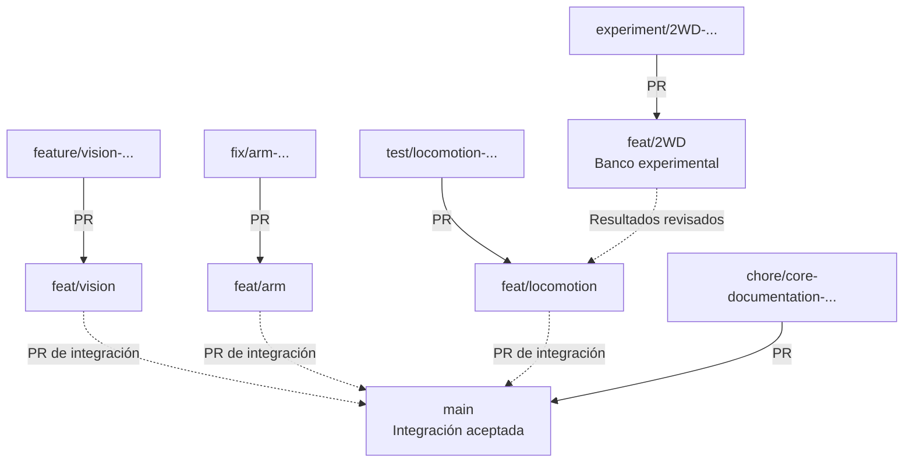

<div align="center">

# PhysalisHarvest

### Selective Cape Gooseberry Harvesting Robot

**Percepción RGB-D · Decisión geométrica · Manipulación robótica · Locomoción móvil · ROS 2**


[](https://github.com/amayadiegoalejandro05/PhysalisHarvest/actions/workflows/ci.yml)

**Semillero SEIMA · Universitaria Agustiniana · Colombia**

[Arquitectura](#arquitectura-del-sistema) · [Subsistemas](#subsistemas-y-responsabilidades) · [Estado actual](#estado-verificable-del-repositorio) · [Primeros pasos](#primeros-pasos) · [Pruebas](#pruebas-y-evidencia) · [Contribuir](CONTRIBUTING.md)

</div>

---

> [!IMPORTANT]
> **PhysalisHarvest es una plataforma de investigación en desarrollo, no un robot de cosecha autónoma ya validado.** La arquitectura siguiente es el **objetivo de integración**. En la base común actual hay políticas, documentación, verificadores de repositorio y un workflow de GitHub Actions. Aún **no hay paquetes ROS 2 funcionales en `ros2_ws/src/`**, contratos definitivos entre subsistemas ni evidencia en este repositorio de cosecha física completada. Un check de CI verde puede incluir `SKIP` en compilación/pruebas ROS del robot.

## El proyecto en un minuto

Una uchuva en planta no es simplemente un punto amarillo que un robot pueda recoger. Su cáliz puede estar parcialmente oculto, la profundidad puede ser incompleta y un objetivo visualmente detectable puede ser inaccesible para un manipulador o estar fuera de una posición segura de la plataforma móvil.

**PhysalisHarvest explora una respuesta modular a este problema:** captar información RGB-D, convertir observaciones visuales en objetivos tridimensionales trazables, distinguir objetivos accesibles de los no accesibles, proponer aproximaciones cartesianas y coordinar esas propuestas con un brazo y una base móvil mediante ROS 2.

La investigación prioriza **evidencia experimental reproducible**, rechazo seguro de objetivos, separación entre percepción y control, y límites claros entre **datos físicos, simulación y funcionalidades proyectadas**.

| Pregunta de ingeniería | Enfoque propuesto |
|---|---|
| ¿Dónde está el objetivo? | Detección de cáliz en RGB + profundidad calibrada → **punto superficial XYZ** |
| ¿Se puede aproximar? | Evaluación geométrica de accesibilidad y obstáculos, con incertidumbre y rechazo |
| ¿Cuál objetivo elegir? | Comparación con una política base, como el objetivo más cercano en 3D |
| ¿Cómo aproximarse? | Trayectoria cartesiana **candidata**, sujeta a validación por el brazo |
| ¿Cómo coordinar equipos? | Contratos ROS 2 con marcos TF, unidades, tiempo, estados y confirmaciones |
| ¿Cómo verificar locomoción? | Banco independiente **2WD** de comunicación, control y parada antes de integrar una plataforma mayor |

## Contenido

- [Arquitectura del sistema](#arquitectura-del-sistema)
- [Subsistemas y responsabilidades](#subsistemas-y-responsabilidades)
- [Contrato de información e integración ROS 2](#contrato-de-información-e-integración-ros-2)
- [Tecnologías y plataformas](#tecnologías-y-plataformas)
- [Estado verificable del repositorio](#estado-verificable-del-repositorio)
- [Ruta de desarrollo y criterios de salida](#ruta-de-desarrollo-y-criterios-de-salida)
- [Primeros pasos](#primeros-pasos)
- [Pruebas y evidencia](#pruebas-y-evidencia)
- [Organización del repositorio](#organización-del-repositorio)
- [Ramas y colaboración](#ramas-y-colaboración)
- [Limitaciones y decisiones pendientes](#limitaciones-y-decisiones-pendientes)
- [Documentación, antecedentes y responsables](#documentación-antecedentes-y-responsables)

---

## Arquitectura del sistema

El siguiente diagrama expresa la **separación funcional prevista**. Las flechas son flujos de responsabilidad; **no** representan tópicos ya implementados ni enlaces físicos validados.



**Principio de seguridad:** una detección no equivale a objetivo aceptado; una ruta candidata no equivale a trayectoria factible; un mensaje recibido no equivale a autorización de movimiento; un `ACK` de comunicación no equivale a ejecución física.

### Recorrido previsto del dato

```text
RGB + Depth + CameraInfo / calibración
           │
           ▼
  Detección de cáliz (RGB)
           │
           ▼
  Correspondencia RGB ↔ profundidad
           │
           ▼
   Punto superficial XYZ + frame + tiempo
           │
           ▼
  Accesibilidad / selección / posibilidad de abstención
           │
           ▼
   Ruta de aproximación candidata
           │
           ▼
      Contrato ROS 2 acordado
           │
      ┌────┴─────────────┐
      ▼                  ▼
 Validación del brazo   Estado de plataforma
      │                  │
      └────┬─────────────┘
           ▼
  Decisión de ejecución supervisada
  (NO IMPLEMENTADA EN LA BASE COMÚN)
```

### Qué representa realmente XYZ

El objetivo geométrico inicial es un **punto de la superficie observada** del cáliz. No debe confundirse con el centro de la baya, el punto de corte del pedúnculo ni una pose de agarre. La coordenada axial `Z` de una cámara óptica no es automáticamente la distancia euclidiana al objetivo, y transformar a `base_link`, `odom`, `map` o `world` exige TF y calibración verificables.

## Subsistemas y responsabilidades

| Subsistema | Rama permanente | Entregables objetivo | Frontera explícita |
|---|---|---|---|
| **Visión y decisión** | [`feat/vision`](https://github.com/amayadiegoalejandro05/PhysalisHarvest/tree/feat/vision) | RGB-D, detección de `calyx`, XYZ, accesibilidad, selección y trayectorias cartesianas candidatas | No controla motores ni certifica una cosecha |
| **Brazo robótico** | [`feat/arm`](https://github.com/amayadiegoalejandro05/PhysalisHarvest/tree/feat/arm) | Cinemática, límites, factibilidad de aproximación, ejecución supervisada y efector según alcance | No hereda automáticamente la validez de una ruta de visión |
| **Locomoción** | [`feat/locomotion`](https://github.com/amayadiegoalejandro05/PhysalisHarvest/tree/feat/locomotion) | Estado y movimiento de plataforma, control y navegación futura | No debe afirmar localización/navegación sin pruebas |
| **Banco 2WD** | [`feat/2WD`](https://github.com/amayadiegoalejandro05/PhysalisHarvest/tree/feat/2WD) | Comunicación, control de dos motores, secuencias, watchdog/parada, ensayos supervisados | No es la base móvil final ni navegación autónoma demostrada |
| **Integración** | PR coordinados hacia `main` | Contratos ROS 2, TF, CI, trazabilidad, comunicación entre subsistemas | Ningún equipo redefine unilateralmente una interfaz compartida |

**Alcance académico de percepción y decisión.** El trabajo de grado de Laura Camila Rincón Malaver y Diego Alejandro Amaya Celis aborda el subsistema de percepción y decisión para cosecha selectiva de uchuva: detección RGB, localización tridimensional, selección por accesibilidad, propuesta de aproximación y comunicación ROS 2. La fabricación de un brazo, el corte físico y la recolección son responsabilidades o metas distintas, **no** requisitos que deban atribuirse automáticamente a ese trabajo de grado.

## Contrato de información e integración ROS 2

**Estado: propuesta para acuerdo entre los equipos.** El documento rector es [`docs/interfaces/contratos-ros2.md`](docs/interfaces/contratos-ros2.md), que aún no especifica interfaces definitivas implementadas. Las siguientes son **propiedades obligatorias por definir**, no una API existente.

| Intercambio previsto | Emisor → receptor | Información mínima a negociar |
|---|---|---|
| Observación y objetivo | Visión → coordinación/brazo | ID local de observación, XYZ, `frame_id`, instante de adquisición, incertidumbre, vigencia y rechazo |
| Aproximación candidata | Visión → brazo | Objetivo asociado, secuencia de puntos/poses, marcos, márgenes, tiempo y validez |
| Evaluación del manipulador | Brazo → coordinación/visión | Aceptado, rechazado, ejecutando, completado, fallo o cancelación con causa y correlación |
| Estado de base | Locomoción → coordinación | Pose si está disponible, frame, tiempo, estado, disponibilidad y condiciones de seguridad |
| Comando experimental 2WD | Nodo de pruebas → receptor de banco | Acción limitada, secuencia, timeout, validación, estado y parada segura **sin nombre definitivo aún** |

Las posiciones se expresarán normalmente en **metros** y los ángulos en **radianes**. Definirán también: marcos ópticos y base, transformaciones, sincronización, QoS, pérdida de enlace, mensajes tardíos, rechazo de `NaN`/infinitos, política de cancelación y quién tiene potestad para autorizar actuadores.

<details>
<summary><strong>Ejemplo didáctico: ¿qué comprueba un PointStamped?</strong></summary>

Un `geometry_msgs/msg/PointStamped` permite transportar un punto con marco y sello temporal; es útil para la fase inicial de comunicación ROS 2 con coordenadas ficticias y receptor independiente. **No** transporta por sí mismo identidad del fruto, incertidumbre, accesibilidad, trayectoria, caducidad ni autorización del brazo. Tampoco demuestra que exista una transformación desde la cámara al robot. No debe convertirse en interfaz definitiva sin aprobación y pruebas del contrato completo.

</details>

## Tecnologías y plataformas

| Componente | Tecnología de referencia | Estado de integración en el repositorio principal |
|---|---|---|
| Middleware | ROS 2 Jazzy / `rclpy`, mensajes ROS y TF2 | **Referente de arquitectura; paquetes funcionales pendientes** |
| Sistema Linux | Ubuntu 24.04, nativo o WSL 2 según equipo | Entorno documentado para una parte del desarrollo; no probado universalmente |
| Simulación | Gazebo, con Harmonic como referencia | Directorios reservados; simulación integrada pendiente |
| Percepción | Cámara RGB-D Astra Pro; RGB, profundidad y calibración | Antecedentes externos de captura; integración al repositorio pendiente |
| Detección | YOLO11n para clase `calyx`, bajo evaluación experimental | No implementado en la base común |
| Visión/algoritmos | Python, OpenCV, NumPy según paquetes que se adopten | Dependencias de cada subsistema por declarar |
| Actuadores | Brazo, controladores y efector por concretar | Sin ejecución certificada en `main` |
| Banco móvil | Chasis de dos ruedas motrices (2WD) | Primera campaña proyectada; electrónica/protocolo por identificar |
| Calidad | Python `unittest`, verificadores Git, GitHub Actions | **Implementado para estructura y CI** |

No se fija aún modelo de controlador 2WD, pines, voltajes, sensores, encoder, comunicación serial o límites de motores: se documentarán después de inventariar el hardware real.

## Estado verificable del repositorio

La siguiente tabla describe **únicamente la base común revisada** y no borra la existencia de antecedentes de investigación fuera de este árbol.

| Elemento | Estado | Qué permite afirmar |
|---|---|---|
| Estructura por subsistemas y ramas de equipo | **IMPLEMENTADO** | Organización de código, propiedad y flujo de PR |
| Políticas, plantillas, documentación y verificadores | **IMPLEMENTADO** | Comprobación estructural y de contexto Git |
| GitHub Actions | **IMPLEMENTADO** | Checks estáticos, prueba aislada de puerta ROS y trazabilidad |
| Paquetes reales bajo `ros2_ws/src/` | **PENDIENTE** | Hay carpetas reservadas, no paquetes ROS funcionales |
| Interfaces ROS entre visión, brazo y base | **PROYECTADO** | Propuestas documentadas, sin aprobación/implementación final |
| Banco físico 2WD desde esta base | **PENDIENTE** | No se documentan todavía pruebas de movimiento |
| Cadena RGB-D → decisión → brazo | **PENDIENTE** | No existe validación integrada en `main` |
| Cosecha física de uchuva | **NO DEMOSTRADA** | No debe afirmarse corte, desprendimiento ni recolección |

> [!NOTE]
> La CI verifica que las comprobaciones disponibles se ejecutan o se omiten de manera explícita. **Una ejecución verde no significa que ROS 2, Gazebo, el 2WD o el robot completo estén validados.** Revisa los resultados por job antes de interpretar el badge superior.

## Ruta de desarrollo y criterios de salida

La siguiente secuencia organiza trabajo **previsto** y habilita entregables pequeños, sin confundir el macroproyecto con los requisitos del trabajo de grado de visión.

| Fase | Objetivo | Evidencia necesaria para avanzar |
|---|---|---|
| **I0 — Comunicación ROS 2** | Publicador/receptor independiente de XYZ ficticio, estados y errores | Tipo, unidad, marco, timestamps, rechazo de mensajes inválidos y logs |
| **I1 — RGB-D real** | Captura de imagen, depth, intrínsecos y correspondencias | Ensayo con referencia externa, error 3D, dispersión, profundidad válida y tiempos |
| **I2 — Decisión** | Accesibilidad y selección de objetivos bajo obstáculos | Escenas con verdad independiente; comparación con baseline 3D |
| **I3 — Aproximación** | Trayectoria candidata, límites y comunicación de estados | Chequeo geométrico, rechazo de rutas inviables, pruebas productor/consumidor |
| **I4 — Integración/simulación** | Reproducción controlada de datos y escenarios Gazebo separados | Configuración, seeds, logs y separación entre sensor/referencia del simulador |
| **B0 — Banco 2WD** | Inventario, protocolo y comandos con motores desconectados o mock | Validación de mensajes, timeout, rechazo y modo seguro |
| **B1 — 2WD supervisado** | Ensayos de giro/marcha/parada bajo protocolo físico aprobado | Registro reproducible de hardware, límites, tiempos, fallos y parada |

**Importante:** estas fases son una propuesta de planificación, no avances ya ejecutados. `I0`–`I4` no exige que los equipos de brazo y locomoción terminen su desarrollo para que visión pueda demostrar su contrato con receptores de prueba. `B0`–`B1` no convierten el carrito en plataforma autónoma.

## Primeros pasos

### 1. Clonar y comprobar la base común

Desde PowerShell de Windows, Ubuntu o Git Bash:

```bash
git clone https://github.com/amayadiegoalejandro05/PhysalisHarvest.git
cd PhysalisHarvest
git remote -v
git branch -a
git status --short --branch
```

Por defecto, el clon abre `main`. Para trabajar en un área, usa una rama temporal creada desde la rama permanente correspondiente, conforme a [CONTRIBUTING.md](CONTRIBUTING.md).

### 2. Verificar la estructura y las pruebas existentes

**PowerShell (Windows, con Python disponible):**

```powershell
python scripts/check_repository.py
python scripts/check_git_context.py --target main
python -m unittest discover -s tests -p "test_*.py" -v
```

**Bash (Ubuntu/WSL 2):**

```bash
python3 scripts/check_repository.py
python3 scripts/check_git_context.py --target main
python3 -m unittest discover -s tests -p 'test_*.py' -v
```

Resultados esperados: informes de comprobaciones con `PASS`, `FAIL` o `SKIP` y resultados de los tests incluidos. **No se fija aquí una cantidad inmutable de tests.** El verificador de contexto compara referencias **locales**: para datos remotos recientes, actualiza con `git fetch origin` cuando esté autorizado. Un directorio con cambios sin confirmar puede producir avisos informativos.

No es necesario instalar ROS 2 ni conectar hardware para ejecutar estas verificaciones estáticas.

### 3. ¿Y para compilar ROS 2?

Cuando se hayan creado paquetes ROS **reales** bajo `ros2_ws/src/` con `package.xml`, dependencias declaradas y entorno compatible, se habilitará el flujo:

```bash
# Solo en un equipo Ubuntu/WSL con ROS 2 Jazzy y colcon ya configurados.
source /opt/ros/jazzy/setup.bash
cd ros2_ws
colcon build
source install/setup.bash
colcon test --return-code-on-test-failure
colcon test-result --verbose
```

**Este bloque no es una instrucción para ejecutar ahora en la base vacía.** Verifica primero distribución, manifiestos, dependencias y comando disponible. No atribuyas la misma configuración de Windows/WSL a todos los colaboradores. Consulta [entorno reproducible](docs/entorno-reproducible.md).

### 4. Inicio del banco 2WD

El trabajo inicial en `feat/2WD` debe comenzar por inventariar componentes, alimentación, cableado y protocolo esperado. Después, diseñar un receptor de prueba **sin motores energizados**, comprobar comandos válidos/inválidos, caducidad, correlación y parada. Solo con revisión de riesgos y autorización se permitirán ensayos supervisados sobre el vehículo físico. No se incluyen comandos de movimiento sin conocer el hardware.

## Pruebas y evidencia

La CI principal está en [`.github/workflows/ci.yml`](.github/workflows/ci.yml). Se ejecuta en PR hacia `main`, `feat/vision`, `feat/arm`, `feat/locomotion` y `feat/2WD`, además de los eventos `push` de esas ramas.

| Job | Qué realiza hoy | Qué **no** demuestra |
|---|---|---|
| **Verificación estática y pruebas** | Validadores de repositorio/contexto y pruebas unitarias existentes | Comportamiento físico, control o percepción |
| **ROS 2 Jazzy** | Busca `package.xml` y compila/prueba **si existen** paquetes | Un `SKIP` no es validación ROS |
| **Prueba controlada de puerta ROS** | Crea un paquete aislado y verifica que el sistema detecte fallos y éxitos de prueba | No ejecuta paquetes del robot |
| **Resumen y trazabilidad** | Registra ramas, SHA, jobs y límites declarados | No reemplaza interpretación de logs o revisión humana |

**Evidencia verificable del establecimiento de la base:** las ejecuciones de GitHub Actions del 19 de noviembre de 2026 para `main` y las cuatro ramas de equipo finalizaron satisfactorias; los pasos de compilación y prueba ROS del robot quedaron omitidos por falta de manifiestos. [Ejecución de `main`](https://github.com/amayadiegoalejandro05/PhysalisHarvest/actions/runs/44575024223) · [Ejecución de `feat/2WD`](https://github.com/amayadiegoalejandro05/PhysalisHarvest/actions/runs/44576094255). Esta evidencia describe **infraestructura**, no un experimento de cosecha.

### Reglas de medición y reproducibilidad

- Distinguir `PROYECTADO`, `IMPLEMENTADO`, `OBSERVADO_EN_SIMULACIÓN`, `MEDIDO_FÍSICAMENTE`, `VALIDADO` y `PENDIENTE`.
- Registrar SHA, entorno, SDK, versiones, parámetros, referencia independiente, método, número de ensayos, logs, fallos, métricas y unidad experimental.
- En RGB-D, distinguir error de **registro en píxeles** de error de **posición 3D en metros**; medir ambos con referencias pertinentes.
- Conservar y reportar rechazos, depth inválida, pérdida de enlace, timeouts y pruebas fallidas; no seleccionar solo escenas exitosas.
- En Gazebo, separar variables de verdad interna del algoritmo de percepción; replay y ruido simulado **no** prueban transferencia al mundo real.
- No usar la observación de un servo o de un chasis 2WD como prueba de planificación autónoma.

<details>
<summary><strong>Cómo interpretar un resultado experimental</strong></summary>

Cada informe reproducible debe permitir responder **qué se probó, con qué versión, bajo qué condiciones, contra qué referencia y qué falló**. Por ejemplo, una medida de Z repetida sin una referencia externa describe dispersión, pero no demuestra exactitud absoluta. Del mismo modo, un receptor ROS que devuelve `ACK` prueba el protocolo observado, no la posición final de una rueda, brazo o fruto.

</details>

## Organización del repositorio

La estructura siguiente corresponde a los directorios principales verificados. Los nombres de los paquetes reservados no constituyen instalaciones de software.

```text
PhysalisHarvest/
├── .github/
│   ├── workflows/ci.yml                 # Verificación de GitHub Actions
│   └── PULL_REQUEST_TEMPLATE.md         # Evidencia y revisión de PR
├── AGENTS.md                             # Política común para agentes
├── CONTRIBUTING.md                      # Flujo de desarrollo y gobernanza
├── README.md                            # Visión técnica de la plataforma
├── docs/
│   ├── arquitectura/README.md           # Decisiones arquitectónicas futuras
│   ├── interfaces/
│   │   ├── contratos-ros2.md             # Propuesta de interfaces, no API final
│   │   └── propuesta-integracion-ros2.md
│   ├── integracion/README.md            # Límites entre productores/consumidores
│   ├── pruebas/                        # CI, verificación local y evidencia
│   ├── entorno-reproducible.md          # Entornos y comprobaciones
│   ├── AI_USAGE.md                      # Registro descriptivo de uso de IA
│   └── ai_usage.json                    # Registro estructurado de IA
├── ros2_ws/
│   └── src/
│       ├── robot_percepcion_decision/    # Área reservada de visión
│       ├── robot_brazo/                 # Área reservada de brazo
│       ├── robot_locomocion/            # Área reservada de locomoción
│       └── robot_interfaces/            # Interfaces futuras compartidas
├── simulacion/
│   ├── gazebo/                          # Recursos de simulación futuros
│   └── modelos/
├── hardware/
│   ├── brazo/
│   └── locomocion/
├── firmware/                             # Software embebido futuro
├── scripts/                              # Verificadores y utilidades CI
└── tests/                                # Pruebas de los verificadores
```

Los archivos `AGENTS.md` locales de `ros2_ws/src/` complementan las reglas de la raíz. El banco `feat/2WD` comparte el área de locomoción, pero sus ensayos permanecen separados por rama y evidencia.

## Ramas y colaboración



Las cuatro ramas `feat/*` son **permanentes**. Para cambios normales se abre una rama temporal desde la rama del equipo y un PR hacia ella. Para README, agentes, contratos y CI **globales**, partir de `main` y proponer un PR a `main`. Después se sincronizan las ramas con los cambios aceptados. No crear PR directamente de 2WD a locomoción sin acuerdo de alcance y criterios de transferencia.

Lee [`CONTRIBUTING.md`](CONTRIBUTING.md) para los pasos detallados, convenciones de commit, política de revisión y manejo de PR. Los cambios que afecten TF, semántica, interfaces o seguridad requieren revisión de los equipos consumidores y productores.

## Limitaciones y decisiones pendientes

- Los contratos de mensajes, nombres de tópicos y acciones aún no están acordados ni implementados.
- La integración física de sensor RGB-D, brazo, plataforma y efector **no** está validada en este repositorio.
- No hay evidencia publicada aquí de cosecha completa, corte, agarre, posicionamiento autónomo o navegación.
- La precisión XYZ del sensor debe caracterizarse frente a una referencia externa independiente; no inferirla de la ficha comercial.
- El modelo 2WD, firmware, alimentación, controladores, límites de movimiento y método de parada deben verificarse antes de energizar motores.
- Las pruebas aisladas o simuladas no deben extrapolarse a campo, iluminación solar o manipulación real.
- La licencia general y los derechos sobre código, datos, anotaciones, pesos, CAD y materiales de terceros requieren decisión de sus titulares. La presencia de YOLO/Ultralytics puede implicar obligaciones de licencia específicas.
- Las protecciones administrativas de ramas y los checks obligatorios deben revisarse en GitHub; escribir una política no las activa automáticamente.

## Documentación, antecedentes y responsables

| Recurso | Uso |
|---|---|
| [AGENTS.md](AGENTS.md) | Política técnica obligatoria para agentes y protección del alcance científico |
| [CONTRIBUTING.md](CONTRIBUTING.md) | Desarrollo por ramas, PR, verificaciones y revisión |
| [Arquitectura](docs/arquitectura/README.md) | Registro de decisiones futuras y límites |
| [Interfaces ROS 2](docs/interfaces/contratos-ros2.md) | Contratos propuestos y acuerdos pendientes |
| [Integración](docs/integracion/README.md) | Separación entre propuestas, consumidores y ejecución |
| [Pruebas y CI](docs/pruebas/ci.md) | Alcance de GitHub Actions, resultados y limitaciones |
| [Entorno reproducible](docs/entorno-reproducible.md) | Plataformas y comandos de comprobación |
| [Prototipo Astra RGB-D × ROS 2 × ESP32](https://github.com/amayadiegoalejandro05/astra-rgbd-ros2-integration) | Antecedente experimental **independiente**, no código ni resultados integrados automáticamente |

**Contexto institucional:** macroproyecto Robot Cosechador del semillero de investigación SEIMA, Universitaria Agustiniana. El trabajo de grado del subsistema de percepción y decisión es desarrollado por **Laura Camila Rincón Malaver y Diego Alejandro Amaya Celis**. Los responsables y contribuciones de los equipos de brazo y locomoción deben identificarse en sus aportes respectivos; no se asignan autorías que no estén verificadas.

**Transparencia:** el proyecto registra el uso real de herramientas de IA en [`docs/AI_USAGE.md`](docs/AI_USAGE.md) y [`docs/ai_usage.json`](docs/ai_usage.json). Las atribuciones y licencias de terceros no se sustituyen por estos registros.

---

<div align="center">

**PhysalisHarvest**

*From observable calyx to verifiable robotic decisions.*

**Objetivos 3D reproducibles · Decisiones con rechazo · Integración segura · Evidencia antes que demostración**

</div>
